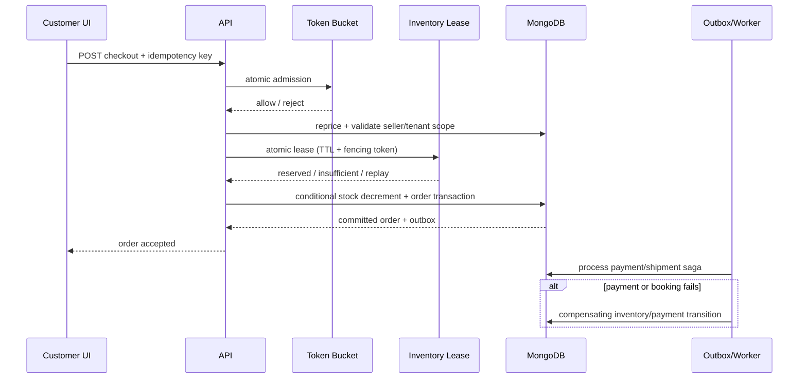
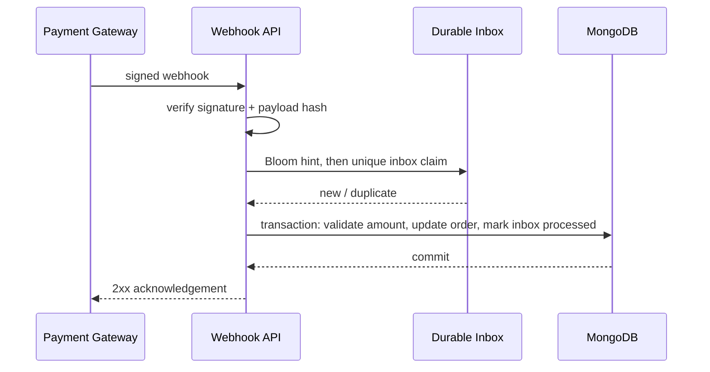

# End-to-End Flow Audit & Hybrid Optimization

**Audit baseline:** `main` at `5925bc4c0d05b453d3ef8f8b58ed6d2059670856` (2026-11-16). This is a source inspection, not a runtime/load-test result. Complexity below distinguishes algorithmic work from persistence/network cost; exact latency requires profiling.

## Monorepo segregation strategy

Keep one repository and one API/domain layer. Preserve current roots and progressively extract features:
- `apps/customer-web`: customer presentation, route guards, typed API client; no database credentials.
- `apps/seller-hub`: seller catalog/orders/campaigns/payment/carrier configuration; seller-scoped DTOs.
- `apps/provider-portal`: provider onboarding/catalog/negotiation/settlement read models.
- `apps/admin-portal` (future extraction): admin/KYC/moderation/operations; do not conflate Admin and Provider permissions.
- `apps/api` (future extraction of `server.ts`): HTTP composition, authentication, policy enforcement and DTO adapters.
- `apps/logistics-worker`: queue consumers only; no UI imports.
- `packages/domain-*`: domain contracts/use cases; `packages/adapters/*`: Mongo, Redis, Supabase/Postgres, payment and carrier implementations.
- `packages/shared-types` and `shared-ui`: presentation-safe contracts/components only. Never export secret-bearing models or database types to browser bundles.

Extraction order: establish import boundaries and contract tests; move customer and seller routes one bounded feature at a time; keep old URLs as adapters; switch deployment routing only after E2E parity. Avoid duplicating the current root app in new workspace apps.

## Existing flow traces and findings

### Checkout / inventory / pricing
Observed path: customer UI -> `/api/orders` in `server.ts` -> cart sanitization/product lookup -> `createOrder` in `src/server/services/store.ts` -> Mongo Order + Product writes -> seller WhatsApp notification -> payment intent after seller confirmation.
- `createOrder` validates each cart item with an awaited product lookup (N sequential reads: O(N) DB round trips), then creates one order per seller and decrements stock in separate writes.
- Stock check and decrement are not one conditional operation. Two buyers can both pass the read and oversell. A mid-loop failure can leave earlier seller orders/stock changes committed while later sellers fail.
- No checkout idempotency key is visible in the inspected function; repeated POST can create duplicate orders.
- Seller notification is synchronous in the request path and can add provider latency.
- Pricing is recomputed from cart snapshots in order creation; the authoritative product price/variant price must be reloaded server-side before reservation.
- In-memory/local JSON mode is not safe for multi-instance concurrency.

### Payment / wallet / ledger
Observed path: seller confirms -> buyer requests payment intent -> Razorpay/Stripe API -> signed webhook -> event claim -> order status mutation. Wallet debit uses Mongo session transaction and a unique idempotency key.
- Wallet amount arithmetic is integer paise and the wallet write is transaction-wrapped, which is a good foundation.
- `claimPaymentEvent` uses a unique (provider,eventId) index, but the event is claimed before amount/currency/business validation and before the order save. A rejected event can become permanently marked processed; a crash after claim but before order update can lose the transition. Move event receipt to RECEIVED/PROCESSING/PROCESSED states and atomically commit event + order transition; use retryable outbox/inbox processing.
- Payment intent creation calls provider before persisting reference; concurrent requests can create multiple intents. Add idempotency key at provider and conditional order transition.
- Wallet redemption debits wallet then conditionally updates order and compensates on conflict; the compensating credit is useful but must be covered by replica-set concurrency tests.

### Fulfillment / logistics
Observed path: seller configures carrier and warehouse -> rates fan out concurrently -> `scoreCarriers` -> shipment intent via Postgres RPC -> logistics worker claims job with `FOR UPDATE SKIP LOCKED` -> carrier booking -> webhook/tracking persisted through SQL RPC.
- Rate fanout is Promise.allSettled (parallel); each carrier has a per-config circuit breaker and timeout; quotes cached in Redis.
- Existing score is normalized weighted scoring, not TOPSIS and does not learn from observed delivery outcomes. RTO is currently hard-coded to 0.5 but its weight is zero; historical performance is therefore not used.
- Job queue claim, webhook status monotonicity, DAG transition and unique event insertion have SQL atomic boundaries. Keep PostgreSQL as source of truth; Redis Bloom is only a prefilter.
- Retry is exponential but lacks jitter. Seller shipment list has a 100-row cap and uses a two-query seller-config lookup then shipments query.

### Search / feed / sync
Observed path: `queryProducts` -> fetches all products and categories -> in-memory filters, scores and sorts -> page slice.
- Current complexity is O(P log P) for ranking/sort plus O(P) filtering and O(P) memory for P catalog products; database/network reads are effectively whole-catalog, not bounded by page size.
- Product/category reads are parallel, but DB-side filtering, cursor pagination and cache/version invalidation should replace whole-catalog loading as catalog grows.
- Existing logistics rate cache is TTL based, with a process-local fallback; no L1 LRU-K or single-flight coalescing was found in inspected implementation.

## Bottleneck matrix

| Flow | Current algorithmic cost | Round trips / latency | Main risk |
|---|---:|---|---|
| Checkout | O(N) product validation; O(N + S) writes for N items/S sellers | N sequential product reads; per-seller order and per-item stock writes | Oversell, partial multi-seller checkout, duplicate checkout |
| Payment | O(1) event-key claim; O(1) wallet mutation | Provider API + Mongo reads/writes; event claim and order save separate | Lost webhook after early claim; duplicate gateway intents |
| Logistics | O(C) parallel carrier fanout + O(C log C) ranking | Config + warehouse reads, C carrier calls, cache get/set, Postgres RPC | No adaptive feedback; retry storms without jitter |
| Catalog | O(P log P), O(P) memory | Full product/category reads before pagination | High DB transfer, CPU and heap pressure |

N = cart lines, S = sellers, C = eligible carriers, P = catalog products. This matrix is based on code paths inspected, not production telemetry.

## Hybrid algorithm blueprint

1. **Carrier routing:** TOPSIS normalizes heterogeneous cost/transit/RTO/priority criteria and ranks by distance to ideal; epsilon-greedy introduces bounded exploration using measured success/RTO rewards. Persist feedback per seller + carrier + service + region with decay and minimum sample thresholds. Do not use global feedback across sellers.
2. **Inventory/checkout:** edge token bucket controls admission; Redis Lua lease can reduce contention but cannot be the final stock authority. Mongo conditional decrement / transaction is authoritative; lease IDs and fencing versions prevent stale lease commits. Orchestrated saga compensates reservations and writes outbox events. Expiry must restore stock exactly once via durable lease state/TTL sweeper; Redis key expiry alone does not run compensation.
3. **Webhook/API resilience:** Bloom filter reduces duplicate lookups but false positives require durable idempotency lookup; never drop a webhook solely because Bloom says present. Durable unique inbox key + atomic state transition is authoritative. Sliding-window breaker isolates providers; decorrelated jitter reduces synchronized retry spikes.
4. **Catalog sync:** content hashes/Merkle roots are worthwhile for large hierarchical catalogs or multi-device sync, not a substitute for database predicates. Add L1 LRU-K + Redis L2 + single-flight, versioned invalidation and cursor-based DB queries.

## Sequence diagrams

### Checkout reservation and saga

### Payment inbox

## Implementation status in this change

The new `packages/hybrid-engine` contains reusable, typed algorithm primitives and unit tests: TOPSIS + epsilon-greedy ranking, Redis Lua token bucket and inventory lease scripts, saga compensation interface, Bloom hint, sliding-window circuit breaker and decorrelated jitter. These are integration primitives, not a claim that production checkout/payment paths are already switched over. Concrete Redis/Mongo adapters, durable bandit feedback storage, saga outbox/reconciler, and end-to-end tests must be wired before enabling them on live traffic.

## Release gates

- Add unique checkout idempotency record and transactionally reserve stock across all seller orders.
- Move webhook processing to durable inbox states and atomic order/event transaction; provider idempotency for intent creation.
- Persist carrier outcome samples and integrate adaptive scoring only after sample-quality/tenant-isolation tests.
- Replace full-catalog scans with indexed DB filters and cursor pagination; add cache version invalidation/single-flight.
- Run Mongo replica-set tests, Redis multi-client concurrency tests, Postgres webhook race tests, provider sandbox contract tests, tenant isolation, load and regression suites.

## Implementation progress (branch update)

The following P0 hardening has now been added on this feature branch:

### Checkout and inventory
- Customer CartDrawer now creates a stable checkout attempt key and sends it in both the `Idempotency-Key` header and request body. The key is retained across retry attempts for the same cart fingerprint.
- Checkout resolves each cart line against the catalog and replaces client-provided seller, title, price, variant description and image fields with catalog values.
- `createOrder` coalesces repeated product/variant lines, sorts product reservation order, and performs conditional stock decrements plus all seller-order inserts inside one MongoDB transaction.
- Variant stock is decremented with array filters in the same transaction as aggregate product stock.
- Coupon usage is conditionally incremented inside the checkout transaction when a MongoDB-backed checkout is used.
- Orders persist a buyer + checkout-key + seller unique key. A replay returns the previously created seller orders and does not resend seller WhatsApp messages.
- Production checkout fails closed if MongoDB transactional persistence is unavailable; local JSON persistence remains a development-only fallback.

### Payment intent and webhook recovery
- Payment intent creation now uses a per-order database lease to prevent concurrent requests from creating multiple active intents.
- Stripe Checkout uses a stable order/provider idempotency key.
- Webhook inbox rows now have PROCESSING/PROCESSED/FAILED states, attempt counts and a 60-second processing lease. Abandoned events can be reclaimed when a gateway retries.
- Payment amount/currency checks occur before inbox claim. Successful order mutation marks the inbox event PROCESSED; in-flight duplicate deliveries receive a retryable 503 instead of a success acknowledgement.
- Repeated capture events are guarded against duplicate timeline mutations when the same transaction has already paid the order.

### Remaining critical limitations
- Payment event inbox claim, order mutation and event completion are not yet a single MongoDB transaction. Recovery relies on lease expiry and idempotent order-state checks. The next hardening step is one transaction spanning inbox + order + refund-return state.
- Stripe supports the stable idempotency header used here. Razorpay order creation does not yet have a verified provider-level idempotency guarantee in this code; an ambiguous network timeout can still require reconciliation before another attempt.
- Carrier bandit feedback is not yet persisted or wired into production rate selection.
- Redis Lua scripts are algorithm primitives; a production Redis adapter, lease-expiry compensation worker and durable fencing-version checks remain to be integrated.
- Catalog filtering still needs DB-side query execution and cursor pagination; L1 LRU-K/L2 single-flight and Merkle delta sync remain outstanding.
- Provider settlement batching, tenant isolation, full role UI-to-DB integration tests, load tests and full regression are not complete.

### Validation state
The CI workflow now runs the existing logistics tests and the new hybrid-engine unit tests in addition to typecheck/build. No CI run has been observed yet for this branch update. Mongo replica-set concurrency tests and provider sandbox tests have not been executed here.

### Adaptive carrier routing integration (P1)
- Added `src/server/migrations/2026-11-carrier-adaptive-feedback.sql`. It persists terminal delivery/RTO outcomes by seller, carrier, service and destination postal prefix.
- Shipment creation now stores the selected service code and destination postal prefix in PostgreSQL.
- The logistics service reads feedback with a short Redis cache, uses TOPSIS + epsilon-greedy ranking, and preserves the existing rate quote response fields for current UI clients.
- Accepted DELIVERED/RTO_DELIVERED tracking events are fed to a SQL function that verifies the event exists in the append-only tracking log and deduplicates outcome increments by shipment/event hash.
- Until the new SQL migration is applied, the service logs feedback unavailability and uses a neutral historical RTO prior; apply the migration before enabling the adaptive algorithm in production.

### Provider settlement batching (P1)
- Seller/Admin settlement batch marking now runs in one MongoDB transaction.
- Every row is conditionally transitioned from READY_FOR_SETTLEMENT to SETTLED; if any requested row is missing, outside the seller scope or no longer payable, the entire batch aborts.
- Audit writes happen after commit and are best-effort; the settlement state remains authoritative if audit delivery fails.
