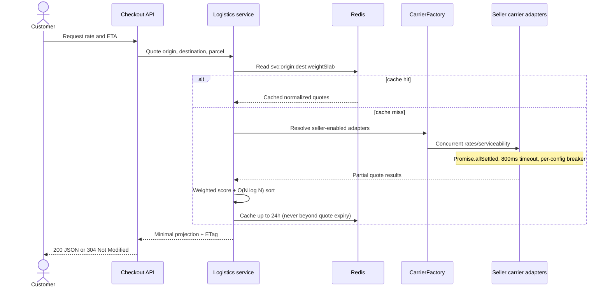
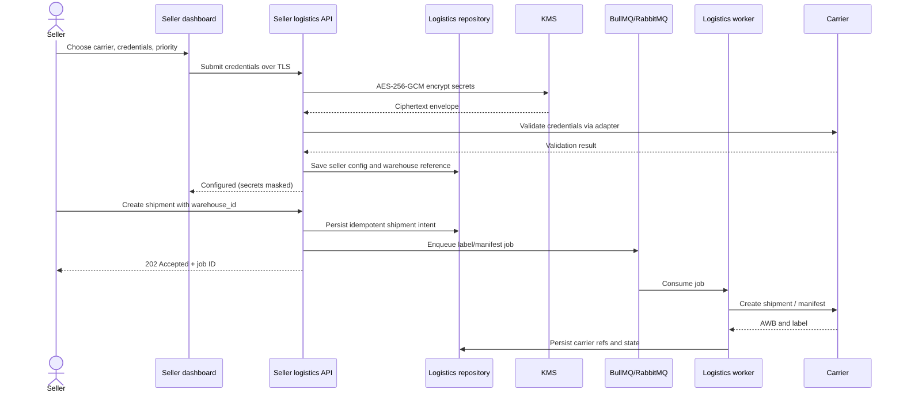
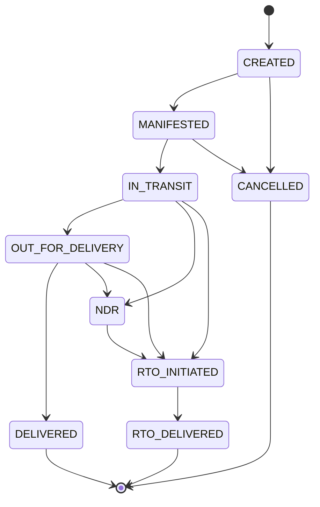
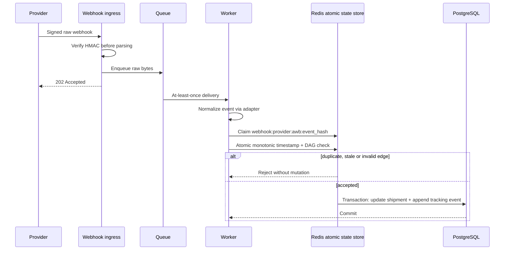

# Multi-vendor logistics engine

## Boundaries and layout

- `@org/logistics-core` owns vendor-neutral DTOs, carrier port/factory, normalized status codes, scoring, timeout/circuit-breaker, HMAC and AES-GCM primitives.
- `packages/adapters/*` own vendor authentication and API/payload transformations. Checkout/order domain code depends only on core ports.
- `shipping-service/src/queue-poller.ts` owns queue consumers; HTTP webhook ingress should verify/queue and return 202 without carrier calls.
- The existing commerce application uses Express + MongoDB/Mongoose + Upstash Redis. The PostgreSQL migration is a separate logistics persistence target, not a hidden replacement or implicit dual-write.

```text
packages/
  logistics-core/src/index.ts
  adapters/shadowfax/src/index.ts
  adapters/shiprocket/src/index.ts
shipping-service/src/webhookProcessor.ts
supabase/migrations/2026-11-logistics-postgres.sql
docs/logistics-engine.md
```

## Customer checkout quote



## Seller onboarding and shipment



## Webhook state machine and processing





## Algorithms and correctness

Carrier utility uses min-max normalization: lower freight cost, transit hours and historical RTO rate score higher; lower seller priority rank scores higher. Weights are normalized by their sum. Sorting is O(N log N). Rate fan-out is concurrent with an 800ms deadline; use a breaker per seller-carrier-config, not a shared global breaker.

The status graph is intentionally acyclic: NDR is terminal except for RTO_INITIATED. If delivery re-attempts are required, model an explicit attempt number or a new forward-only retry state rather than adding a backward edge. The webhook store port must atomically compare expected current status and timestamp, enforce the DAG edge, insert the unique event and update the shipment in one database transaction. Use Redis keys webhook:{provider}:{awb}:{event_hash} as a fast duplicate filter/cache, but keep the PostgreSQL unique event constraint and row-locked transaction authoritative so a Redis/DB crash cannot silently lose an event.

Cache key base is `svc:{origin_pin}:{dest_pin}:{weight_slab}`; add COD, dimensions, currency and service class to the key whenever they affect rates. TTL is at most 24h and must not exceed provider quote expiry. ETag hashes the canonical response projection.

Customer tracking returns only status, ETA and latest checkpoint. Seller tracking can additionally expose AWB, label URL, warehouse reference, NDR/RTO actions and timeline. Never return credentials.

## API boundary proposal

- GET /api/logistics/providers — public provider catalog and safe auth schema.
- GET/POST /api/seller/logistics/carriers — seller-owned configs; mask secrets in responses.
- POST /api/seller/logistics/warehouses — normalized pickup locations.
- POST /api/logistics/rates — checkout quote for the seller(s) in the cart.
- POST /api/seller/logistics/shipments — enqueue shipment/label generation; return 202.
- GET /api/orders/:orderId/tracking — customer minimal projection + ETag/304.
- GET /api/seller/logistics/shipments/:id — seller shipment detail.
- POST /api/logistics/webhooks/:providerCode — verify raw-body signature, enqueue, return 202.

Resolve seller ID from the authenticated principal, never from untrusted request JSON. Check customer order ownership on tracking reads. Label PDFs, bulk manifests and webhook processing belong on the queue; the <50ms target is achievable for ingress/enqueue, not for carrier network round trips.

## Security, schema and rollout

PostgreSQL DDL is in `supabase/migrations/2026-11-logistics-postgres.sql`. Seller credentials and webhook secrets are AES-256-GCM envelopes encrypted with a KMS-managed 32-byte key. Warehouse address data lives once in warehouses; shipments reference warehouse_id. Tracking events are append-only and unique by shipment + event hash.

The adapter paths, authentication headers and sample response fields are illustrative seams, not verified vendor contracts. Before enabling a provider in production, use its current partner documentation and sandbox to confirm auth, query/body encoding, HMAC header/algorithm, payloads, rate limits and label workflow. Add fixture-based contract tests. Adapter instances and token caches must be scoped to one seller config; never reuse an authenticated Shiprocket token across sellers.


## Checkout delivery pricing — Option 3 (separate fee)

- Checkout silently requests rate/ETA estimates when the authenticated cart opens or changes. The request sends catalog product identifiers and quantities; the API resolves public slugs to canonical Mongo product ObjectIds before any ObjectId query.
- The rate response includes carrier cost in minor currency units, seller markup in minor units, and customer delivery charge. The checkout displays the first ranked quote for each seller as an estimate.
- Sellers configure `sellerProfile.shippingMarkupPercent` from the Seller Hub logistics panel. The authenticated seller-only endpoints are `GET/PATCH /api/seller/shipping-policy`; accepted markup is 0–100%, default 0%.
- On order submission, the server independently reloads seller policy and fetches a fresh quote for each seller parcel. The browser cannot set the fee. A missing quote fails checkout with a retryable delivery-quote error rather than silently charging zero.
- The order snapshot stores actual carrier cost, seller markup, customer delivery charge, carrier/service, ETA and quote expiry. `totalAmount` includes the separately charged delivery fee so payment intent amount and order amount remain aligned.
- Carrier amount is stored in INR rupees on the order; provider quote amount is handled in paise/minor units at the adapter boundary. Insurance is recorded separately and remains zero unless a provider-backed insurance premium is explicitly returned and implemented; do not label an order insured based only on a quote.
- The local JSON development fallback uses a non-ObjectId `local_` domain ID and skips Mongo-only order update/notification lease queries. Mongo-backed order writes use the persisted ObjectId, never the business order number.
